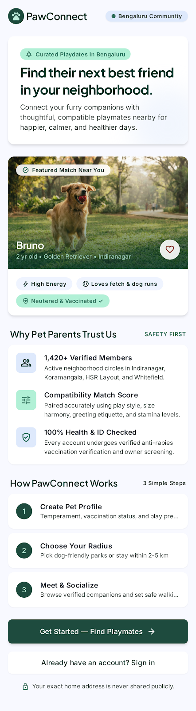
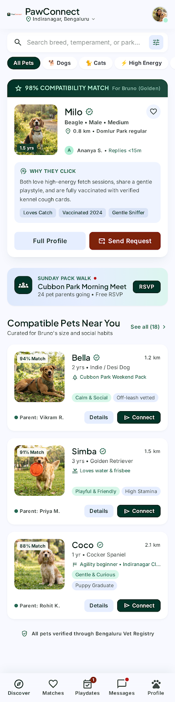
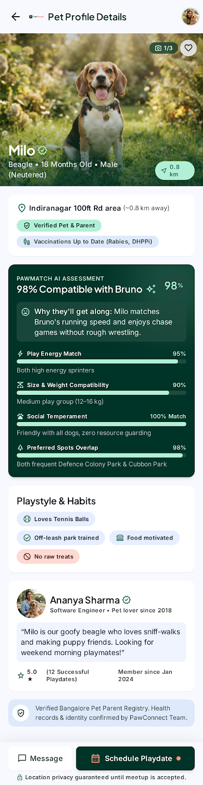
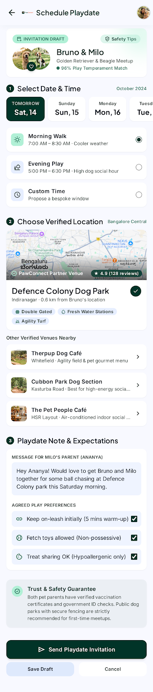
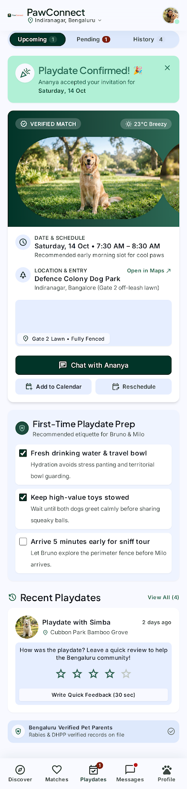

<div align="center">
	
	<h1>PawConnect</h1>
	<p><strong>Better neighborhood days, for every pet.</strong></p>
	<p>A mobile-first product concept for discovering nearby companions and making playdates happen.</p>
	<p><strong>Bengaluru, India</strong> &nbsp;|&nbsp; Independent product design portfolio</p>
	<p>
		<a href="index.html"><strong>Explore the portfolio</strong></a> &nbsp;·&nbsp;
		<a href="#screen-journey">See the screens</a> &nbsp;·&nbsp;
		<a href="context.md">Product context</a>
	</p>
</div>

---

## The idea

Finding a good playmate for a pet is only half the job. Owners also need enough context to feel comfortable connecting and a simple way to agree on a time to meet. PawConnect explores that local discovery-to-playdate journey, beginning with a Bengaluru neighborhood community.

This repository is a **static visual concept**, not a live service. The audience and product opportunity are hypotheses; no user research or matching outcomes are claimed.

## Screen journey

<table id="screen-journey">
	<tr>
		<td align="center" width="20%"><a href="screens/welcome_to_pawconnect/code.html"></a><br><strong>01 · Welcome</strong><br><a href="screens/welcome_to_pawconnect/code.html">Open screen</a></td>
		<td align="center" width="20%"><a href="screens/discover_compatible_pets/code.html"></a><br><strong>02 · Discover</strong><br><a href="screens/discover_compatible_pets/code.html">Open screen</a></td>
		<td align="center" width="20%"><a href="screens/pet_profile_milo/code.html"></a><br><strong>03 · Profile</strong><br><a href="screens/pet_profile_milo/code.html">Open screen</a></td>
		<td align="center" width="20%"><a href="screens/schedule_playdate/code.html"></a><br><strong>04 · Schedule</strong><br><a href="screens/schedule_playdate/code.html">Open screen</a></td>
		<td align="center" width="20%"><a href="screens/playdates_hub_confirmation/code.html"></a><br><strong>05 · Playdates</strong><br><a href="screens/playdates_hub_confirmation/code.html">Open screen</a></td>
	</tr>
</table>

## Design direction

**Botanical Warmth** pairs deep garden green with mint, cool sky surfaces, and a small coral accent. Plus Jakarta Sans carries display moments; Inter keeps interface details easy to scan. The included tokens live in [`screens/botanical_warmth/DESIGN.md`](screens/botanical_warmth/DESIGN.md).

## Explore locally

Open [`index.html`](index.html) directly, or serve the folder to preview the pages with relative assets:

```powershell
python -m http.server 8000
```

Visit `http://localhost:8000/`. The supplied screens use external Tailwind, font, and image URLs, so those pages may need an internet connection. Their PNG previews are included locally.

## Project notes

- [Product context](context.md): problem hypothesis, audience, principles, and open questions.
- [Project plan](plan.md): validation, safety and privacy work, and portfolio milestones.
- [`screens/`](screens/welcome_to_pawconnect/code.html): five HTML concepts, five screen captures, and design tokens.

## Status and publishing notes

The current work demonstrates visual direction and a proposed user journey. It does not include accounts, pet data, matching logic, scheduling persistence, notifications, or a backend. The next milestone is to test the journey with pet owners and resolve location, consent, trust, and safety requirements.

To publish the portfolio page with GitHub Pages, push the repository and select **Settings → Pages → Deploy from a branch → `main` → `/(root)`**. The repository page will show the generated URL.

Before making the repository public, confirm publishing rights for all supplied and externally referenced imagery. No license is included because asset rights have not been established.